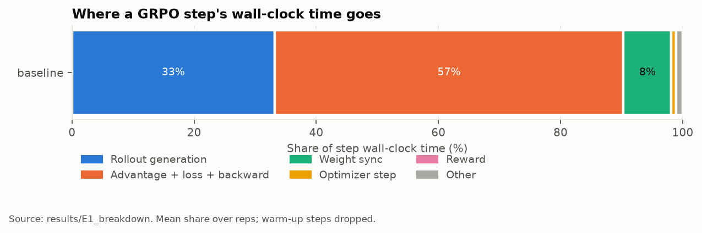

# Profiling the Rollout Path of LLM Reinforcement Learning

A working GRPO post-training loop (Qwen2.5-1.5B on GSM8K math, verifiable exact-match rewards, TRL trainer + vLLM sampler sharing one GPU), instrumented to attribute **every training step's wall-clock time** to rollout, reward, loss/backward, optimizer, and trainer→sampler weight sync.

Run on an NVIDIA H100 80GB (Georgia Tech PACE). 48 training runs, 3 seed-paired reps per configuration. Every number resolves to a committed artifact in [`results/`](results/) with its Slurm job ID, GPU, seed, and git SHA.

| | question | result |
|---|---|---|
| **E1** | where does a step's time go? | rollout **33%**, scoring + loss + backward **57%**, weight sync **8%** of a 2.27 s step |
| **E2** | rollout cost vs samples per prompt | **4×** the samples cost only **1.66×** the rollout time |
| **E3** | generation-length cap | 128→512 tokens: answers **2.2×** longer, rollout **3.0×** slower; only **40%** of decode slots busy |
| **E4** | weight-sync cost | **0.18 s** per sync with the GPU busy **2%** of it; syncing every 16 steps saves **7.6%** |
| **E5** | vLLM vs HF `generate` | vLLM generates **7.9×** faster despite its sync and correction-pass overhead |
| **E6** | held-out accuracy | **23% → 71%** (strict format); format-agnostic **66% → 71%** |
| **E0** | measurement overhead | **0.4%** of step time |



## Key findings

- **Rollout was not the bottleneck at this scale.** The trainer side was larger, including a 13%-of-step correction pass that exists only because the sampler and trainer are separate engines.
- **Weight sync is idle GPU time.** It pushes 338 tensors one call at a time; the GPU does ~3.5 ms of work inside a 180 ms sync. The driver's NVML counter misreported this as 80% busy; kernel traces showed 2%.
- **Rollout time follows the longest sample, not the average,** so long-tail generation leaves most of the batch idle.
- **Held-out accuracy gains were mostly format learning.** A format-agnostic metric separated it from the modest real math gain (+5 points).

## How it works

- **Timing:** a GPU-synchronized step timer charges each stage its exclusive time, so stages always sum exactly to wall clock (`rlstudy/timing.py`).
- **Hooks:** `ProfiledGRPOTrainer` subclasses TRL's `GRPOTrainer` and adds a configurable sync interval for E4 (`rlstudy/instrumented.py`).
- **GPU activity:** `torch.profiler` kernel traces measure how busy the GPU is inside each stage.
- **Experiments:** each experiment's arms run interleaved in one Slurm job on one GPU, and are resumable.
- **Tests:** 117 tests, including the timer on a simulated asynchronous GPU.

**Stack:** PyTorch 2.13 (CUDA 12.9) · vLLM 0.30 · TRL 1.14 · transformers 5.17 · Slurm · 2.9 H100-hours total.

## Quick start

```bash
uv venv --python 3.12 .venv && uv pip install --python .venv/bin/python -e ".[train,analysis,dev]"
make test            # fast unit tests, no GPU
make baseline        # instrumented baseline loop on a CUDA GPU
make analyze figures # tables and charts from results/
```

## More

[`WRITEUP.md`](WRITEUP.md) (full report and mechanisms) · [`DECISIONS.md`](DECISIONS.md) (why TRL over veRL, pinned versions) · [`PROGRESS.md`](PROGRESS.md) (run log, failures, fixes) · [`FUTURE.md`](FUTURE.md) (next steps)

MIT License.
